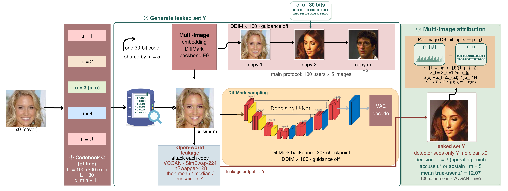

# AttribuMark

**User-level watermark attribution for deepfake forensics, with controllable rejection.**

AttribuMark is an attribution layer that sits on top of a diffusion-based image watermark. Instead of asking *"does this image carry message m?"*, it asks *"which account does this leaked image belong to — and is the evidence strong enough to accuse anyone?"*

Every user receives a fixed 30-bit codeword. Each leaked image is decoded into per-bit probabilities, converted to log-likelihood ratios (LLRs), and accumulated across all images attributed to the same account. The system accuses the best-matching user only when the aggregated evidence score passes a calibrated threshold; otherwise it **abstains**. On CelebA-HQ 128×128, five leaked images raise the true user's evidence score from about 5.4 to 12.1 while naive probability averaging stays flat at 5.3.



The diffusion backbone is DiffMark (INFFUS'25). This repository adds the user-level codebook, the multi-image evidence aggregation, and the rejection decision — the backbone's encoder and decoder are used as-is. See the original paper for the backbone design.

## Why an attribution layer

Single-image watermarking answers a message-level question. Forensics usually faces a different one: several images are claimed to come from the same suspect, and the analyst must decide whether the evidence justifies an accusation. Two failure modes matter:

- **Collusion.** Several users mix their protected images; the mixture may not decode to any single codeword.
- **Deepfake pipelines.** Reconstruction (VQGAN) and face swapping (SimSwap, InSwapper) partially destroy the watermark signal.

Averaging per-bit probabilities does not help here, because a confident single image saturates the average. Log-likelihood ratios do add up, so evidence grows with the number of images — which is exactly what a multi-image investigation needs.

## Method in one paragraph

For image *j* and bit *i*, the decoder gives p(j,i). The LLR is `LLR(j,i) = log(p/(1-p))`. For a candidate codeword c, the score is `Σ_j Σ_i (2c_i-1)·LLR(j,i)`, normalised by `sqrt(Σ_j Σ_i LLR(j,i)^2)` to obtain z(c). The candidate with the largest z is accused if z ≥ τ (default τ = 3); otherwise the system reports insufficient evidence. Thresholds can be calibrated against a null distribution of random codewords, and the false-accusation rate is bounded via a sub-Gaussian/Chernoff argument — the practical consequence is that stronger attacks mostly convert into abstentions rather than wrong accusations.

## Results

### Watermark quality (CelebA-HQ 128×128, 500 test images)

| PSNR | SSIM | LPIPS | BER |
|---:|---:|---:|---:|
| 33.86 dB | 0.9258 | 0.0392 | 0.127% |

### Single-image decoding under deepfake attacks (100 users × 5 images)

| Attack | BER | 30-bit exact | Mean / max Hamming |
|---|---:|---:|---:|
| VQGAN reconstruction | 0.080% | 97.6% | 0.024 / 1 |
| SimSwap-224 | 0.120% | 97.2% | 0.036 / 2 |
| InSwapper-128 | 0.073% | 98.0% | 0.022 / 2 |

With 500 users and one image each, top-1 attribution is 100% for all three attacks (BER 0.053% / 0.173% / 0.060%).

### Multi-image evidence growth (true user's z, all non-empty subsets)

| m | 1 | 2 | 3 | 4 | 5 |
|---|---:|---:|---:|---:|---:|
| VQGAN | 5.40 | 7.64 | 9.35 | 10.80 | 12.07 |
| SimSwap-224 | 5.39 | 7.62 | 9.34 | 10.78 | 12.05 |
| InSwapper-128 | 5.41 | 7.65 | 9.37 | 10.82 | 12.10 |
| Probability averaging | 5.40 | 5.37 | 5.36 | 5.35 | 5.34 |

Top-1 is 100% for every subset in every attack condition.

### Collusion (100 groups, five-fold threshold calibration at a 0% false-accusation budget)

| Attack / mix | k=2 | k=3 | k=4 | k=5 |
|---|---:|---:|---:|---:|
| VQGAN, mean — detect (abstain) | 98.0% (2%) | 68.0% (31%) | 26.0% (73%) | 41.0% (58%) |
| SimSwap-224, mean — detect (abstain) | 99.0% (1%) | 81.0% (18%) | 56.0% (43%) | 53.0% (46%) |
| SimSwap-224, mosaic — detect (abstain) | 53.0% (45%) | 22.0% (77%) | 8.0% (92%) | 6.0% (94%) |

As collusion grows, detection falls and abstention rises; the false-accusation rate stays at 0–2%. Mosaic is the strongest attack we tested. Under high collusion the system says "not enough evidence" rather than naming the wrong user.

### Cross-dataset (FFHQ, same checkpoint, no retraining)

| Condition | BER | 30-bit exact | m=5 z | Top-1@100 |
|---|---:|---:|---:|---:|
| Clean | 0.01% | 99.8% | 12.17 | 100% |
| VQGAN | 0.51% | 86.0% | 11.93 | 100% |
| SimSwap-224 | 0.10% | 97.2% | 12.05 | 100% |
| InSwapper-128 | 0.12% | 96.4% | 12.06 | 100% |

FFHQ's VQGAN condition is visibly harder at the single-image level (86.0% exact vs 97.6% on CelebA-HQ), yet five-image aggregation still recovers 100% top-1. Per-image degradation is compensated by multi-image evidence — but this must be reported as a per-image regression, not hidden behind the aggregate number.

## Repository layout

```
AttribuMark/
├── configs/               # train/test YAML
├── data/                  # 4 sample images at 128 and 256 (for smoke tests)
├── docs/
│   ├── figures/           # fig1..fig8 from the manuscript
│   └── reports/           # experiment reports (Markdown)
├── guided_diffusion/      # backbone: diffusion, UNet, training loop
├── models/                # encoder/decoder and related networks
├── noise_layers/          # attack layers (code only, weights not included)
│   ├── ldm/               # VQ-f4 autoencoder wrapper (VQGAN attack)
│   ├── simswap/           # SimSwap-224
│   └── inswapper/         # InSwapper-128 (ONNX)
├── paper/                 # manuscript (Chinese, v29, TMM template)
├── results/               # codebook + aggregate JSON used by the analyses
├── scripts/               # codebook, training, evaluation, analysis
├── utils/
└── environment.txt
```

## Setup

```bash
conda create -n attribumark python=3.8 -y
conda activate attribumark
pip install torch==1.12.1+cu116 torchvision==0.13.1+cu116 --extra-index-url https://download.pytorch.org/whl/cu116
# then install the remaining packages exactly as listed in environment.txt
```

Face-swap attacks additionally need `onnxruntime`, `insightface`, `opencv-python` (see `noise_layers/inswapper/` and `noise_layers/simswap/`).

### Weights that are not in this repository

| Component | Expected path |
|---|---|
| VQ-f4 autoencoder | `noise_layers/ldm/models/checkpoints/vq-f4/model.ckpt` |
| SimSwap-224 | `noise_layers/simswap/checkpoints/people/latest_net_G.pth`, `noise_layers/simswap/arcface_checkpoint.tar` |
| InSwapper-128 | `noise_layers/InSwapper-128/inswapper_128.onnx` |
| InsightFace models | `noise_layers/insightface_models/` |
| DiffMark 128 checkpoint | `results/<run>/model030000.pt` |

Download the [VQ-f4 checkpoint](https://ommer-lab.com/files/latent-diffusion/vq-f4.zip) from Stable Diffusion; SimSwap and InSwapper weights come from their own projects and are subject to their licences.

## Usage

**1. Build a user codebook**

```bash
python scripts/make_codebook.py --num_users 100 --message_length 30 \
    --target_min_distance 11 --output_json results/codebook_100x30_min11.json
```

A BCH-derived variant with a 500-user codebook is produced by `scripts/make_bch_codebook.py`.

**2. Train the backbone (optional)**

```bash
python scripts/image_train.py --data_dir CelebA-HQ/train_128 --batch_size 16 \
    --lr 1e-4 --lr_anneal_steps 30000 --save_interval 1000
```

Training flags follow the guided-diffusion defaults; run `--help` for the full list.

**3. Single-image / multi-image evaluation**

```bash
python scripts/user_fingerprint_eval.py \
    --model_path results/<run>/model030000.pt \
    --data_dir CelebA-HQ/test_128_500 \
    --codebook_json results/codebook_100x30_min11.json \
    --noise_layer "VQGAN()" --num_users 100 --images_per_user 5
```

`--noise_layer` accepts `"VQGAN()"`, `"SimSwap()"`, `"InSwapper()"`, or several layers joined with `;`.

**4. LLR aggregation and evidence curves**

```bash
python scripts/analyze_multimage_llr.py \
    --input_json results/user_fingerprint_eval_30k_min11_probs.json \
    --output_json results/multimage_llr_summary.json --output_txt results/multimage_llr_summary.txt
```

**5. Collusion**

```bash
python scripts/user_collusion_eval.py \
    --model_path results/<run>/model030000.pt \
    --num_groups 100 --min_k 2 --max_k 5 --mix mean --noise_layer "SimSwap()"
```

`--mix` is one of `mean`, `median`, `mosaic`.

## Datasets

Not included. The main experiments use a 128×128 CelebA-HQ subset (100 users × 5 images = 500 test images) and a matched FFHQ subset for cross-dataset evaluation.

- [CelebA-HQ](https://mmlab.ie.cuhk.edu.hk/projects/CelebA.html)
- [FFHQ](https://github.com/NVlabs/ffhq-dataset)

## Limitations

- **Geometry is the weak point.** At 90% centre crop, BER rises to 38.6% and top-1 falls to 12%; 87% of cases end in abstention. Even when the true crop ratio is given to a restoration step, BER stays around 36.5%. Post-hoc geometric synchronisation is not a fix; it needs training-time augmentation or an explicit alignment module.
- **The main results are from one dataset** (CelebA-HQ 128), with FFHQ as a cross-dataset check and 256×256 as a feasibility study (PSNR 27.95 dB at DDIM-10 steps, after a 3,000-step resolution adaptation).
- **The backbone still matters.** Under a HiDDeN backbone with its official checkpoint, VQGAN attack leaves BER 32.8% and top-1 66%. The attribution layer only requires per-bit probabilities, so it is backbone-agnostic at the interface level — not in accuracy.
- **Collusion at large k is hard.** Mosaic with k ≥ 4 leaves 8% or less detection; the system abstains rather than accusing.

## Citation

The manuscript is under preparation. Until a preprint is available, please cite this repository:

```bibtex
@misc{attribumark2026,
  title  = {AttribuMark: User-Level Watermark Attribution for Deepfake Forensics with Controllable Rejection},
  author = {<author list>},
  year   = {2026},
  note   = {https://github.com/<your-account>/AttribuMark}
}
```

## Licence and acknowledgements

Released under the Apache-2.0 licence (see `LICENSE`). The diffusion backbone, training loop and attack wrappers are derived from DiffMark; SimSwap, InSwapper and the VQ-f4 autoencoder remain under their original licences. Please cite the original works if you use those components.

---

## 中文速览

本项目在 DiffMark 扩散水印之上加了一层**用户级归因**：每个用户分配固定 30-bit 码字，同一用户的多张图共享该码字；把逐图解码概率转成对数几率后跨图累加，得到候选用户的证据分 z；只有当 z 超过校准阈值时才指控，否则输出"证据不足"。这样就把"单图消息验证"变成了"账号级溯源 + 可控拒识"。

在 CelebA-HQ 128×128 上，干净水印 PSNR 33.86 dB；VQGAN、SimSwap-224、InSwapper-128 三种攻击下单图 BER 均低于 0.13%，5 图聚合后真实用户 z 从约 5.4 升到约 12.1，Top-1 为 100%。100 组合谋实验中，合谋规模增大主要表现为检出率下降、拒识率上升，误指控率保持在 0–2%。主要短板是几何攻击：90% 中心裁剪下 Top-1 只有 12%。